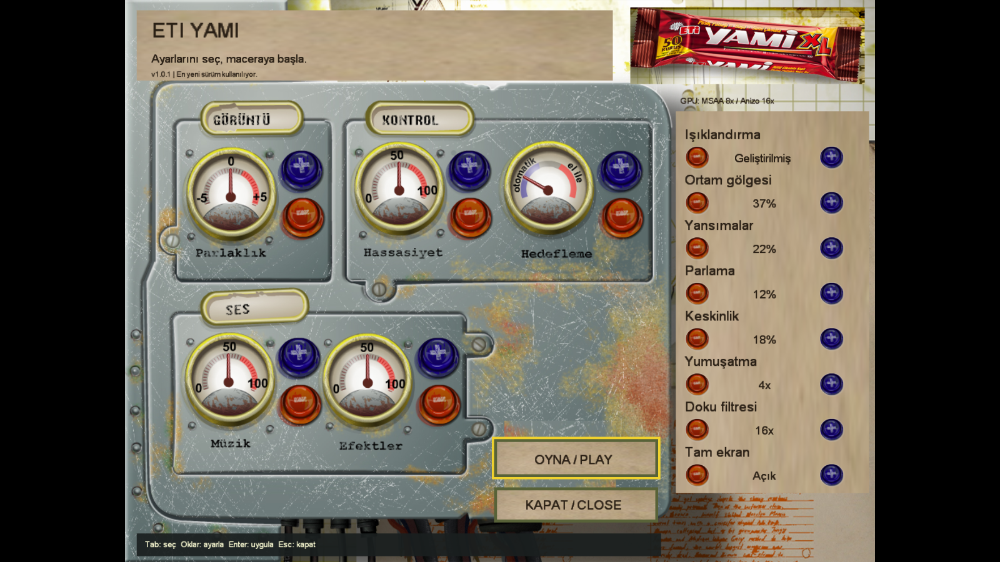

# ETI Yami Native — Linux and Windows

A native C++20/SDL3 reconstruction of **ETI Yami**, using the original game's artwork, models, scripts, audio, and videos. **v1.5.0 adds a day/night cycle with nighttime lighting and fixes the crash after the first mission's ending cinematic** alongside IKV-style parallax occlusion mapping, renderer optimizations, the settings launcher, OpenGL/GLES rendering, Vulkan/optional ray tracing, AMD FSR 3.1.4 upscaling and optional frame generation, enhanced character-pose interpolation and shadows, widescreen support, checkpoints, and automatic launcher/engine updates. No Wine, DirectX installer, or Windows codec installation is needed.

**The original game assets are not included in this repository or release downloads. You need a legitimate copy of the original game.** Linux releases are available for x86_64 and ARM64; Windows is available for x86_64. macOS releases are deferred.

**v1.5.0 is public/latest:** [the day/night and mission-transition release](https://github.com/sergen213/etiyami/releases/tag/v1.5.0), tagged from source `c8542f9`, contains eight Windows and Linux artifacts. Fresh public downloads matched the locally validated Windows ZIP/installer and Linux ZIP, `.run`, and AppImage files byte-for-byte. The x86_64 AppImage printed `ETI Yami Linux setup 1.5.0` through forced extraction. Native Windows GPU/GLES execution and physical ARM64 GPU execution remain uncertified.

Installer-created uninstall scripts and shortcuts require **installer 1.0.3 or newer**, available in [the public v1.0.3 release](https://github.com/sergen213/etiyami/releases/tag/v1.0.3); the 1.0.2 installer does not provide them.

Installer **1.0.4** fixes the Linux portal-picker freeze affecting **Choose ISO**, **Change...**, and picker cancellation/error responses. The corrected AppImage and `.run` installers are publicly available in [v1.0.4](https://github.com/sergen213/etiyami/releases/tag/v1.0.4), published from source commit `d0d7d8209e40a130a7890a6a1f47966a07149d31`: all four jobs in [run 37566309522](https://github.com/sergen213/etiyami/actions/runs/37566309522) passed native Ubuntu 22.04 x86_64/ARM64 builds, glibc-2.35 packaging, and installer self-tests. This CI package proof is separate from the local source GUI checks below, not a public GUI installation or live portal-popup test. Redownload the corrected installer if you have an older copy; the game's automatic launcher/engine update does **not** replace an old downloaded installer.

**v1.2.2 is historical:** [the automatic-update compatibility hotfix](https://github.com/sergen213/etiyami/releases/tag/v1.2.2), tagged from source `f33f3bf28739e680bbbf8653cdd58f1b3042669e`, passed metadata, native Ubuntu 22.04 x86_64/ARM64 builds and publication in [run 40101765300](https://github.com/sergen213/etiyami/actions/runs/40101765300). All six public downloads match their GitHub SHA256 digests; both update ZIPs and `.run` installers passed local policy validation, and the public x86_64 AppImage printed `ETI Yami Linux setup 1.2.2` through forced extraction. A genuine installed v1.2.0 launcher clone used normal latest-release updating, committed through its unmodified trusted old helper and restarted v1.2.2; all 28 updated engine/library files matched the public ZIP and no update stage remained. Earlier release artifacts were not replaced.

**v1.1.1 is historical:** [the graphics/installer patch](https://github.com/sergen213/etiyami/releases/tag/v1.1.1), tagged from source `6b120645a71a160fb3dc2d1a2246d7a818be550c`, passed all four jobs in [run 37804347387](https://github.com/sergen213/etiyami/actions/runs/37804347387): metadata, native Ubuntu 22.04 x86_64/ARM64 builds, and six-asset digest-gated publication. All six anonymous downloads passed sizes/SHA256 and package-policy validation; the downloaded x86_64 AppImage installed the original ISO with Desktop disabled, and eight installed-game paths passed at 2560×1440. A genuine installed v1.1.0 launcher updated through its trusted old helper and restarted v1.1.1; the unchanged Apps entry and upgraded real-game level 2 also worked. Final comparisons preserved assets, saves, shortcuts and all graphics preferences; a **0.000010** music-value serialization change means settings are not claimed byte-identical. Native ARM64 CI/package proof is not physical GPU execution. OpenGL remains the default and the choice for older hardware; Vulkan and hardware RT are optional.

**v1.2.2 changes** keep update ZIPs flat for the v1.2.0 updater and its ownership inventory, embed the pinned FidelityFX MIT notice in `yami-native`, and retain a readable copy in installers. The release includes v1.2.1's AMD FSR 3.1.4 upscaling, optional frame generation, interpolated enhanced character poses, and Vulkan lighting, fog, moving-shadow and history corrections. FSR sharpening is available through the shared sharpening control; OpenGL/GLES and classic-graphics paths are retained. Source and public-package verification are recorded separately below, with motion image-quality, frame-pacing, alpha-sprite and physical-ARM64 limitations preserved.

[Windows install](#install-on-windows) · [Linux install](#install-on-linux-recommended-appimage) · [Uninstall](#uninstall-an-installer-created-game) · [Manual ZIP](#advanced-manual-zip-installation) · [Controls](#game-controls) · [Saves](#saves-and-settings) · [Updates](#automatic-updates) · [Source build](#build-from-source) · [Troubleshooting](#troubleshooting) · [Checks](#checks-and-technical-details)

## Install on Windows

Download **[yami-setup-windows-x86_64.exe](https://github.com/sergen213/etiyami/releases/latest/download/yami-setup-windows-x86_64.exe)** from the latest release. This single-file offline installer supports 64-bit Windows 10/11. Packages are not Authenticode-signed, so SmartScreen may report **Unknown publisher**; verify the download's GitHub SHA256 digest before running it.

1. Run the installer as your normal user, without elevation. Click **Choose ISO** and select your legally owned original Turkish Yami ISO. The installer reads MSI/CAB data directly and never runs the disc's setup, DirectX, or codec installers.
2. Wait for the original artwork preview. The default installation is `%LOCALAPPDATA%\Programs\etiyami`; **Change...** selects another per-user parent folder. Keep the installation writable so automatic updates work.
3. Click **Install game**, then **Launch game**. The installer creates **ETI Yami** and **Uninstall ETI Yami** in Start Menu → **ETI Yami**, plus optional Desktop shortcuts. It bundles application DLLs and the offline ISO tool, not original game assets or saves.

Installation needs about 640 MiB free temporary space for artwork preview and 1.5 GiB plus the engine on the destination volume. The ISO is not needed afterward. Re-running repair against an installer-owned installation preserves its engine, assets, settings, saves, and unknown files while repairing shortcuts and removal support. Unrelated folders and shortcuts are not overwritten.

To uninstall, close the game/launcher/updater and open **Uninstall ETI Yami**. The console shows the exact installation path and asks for confirmation. Only inventory-owned game/engine files and shortcuts are removed. Saves, settings, custom/unrecorded files, and the installation root remain. The original ISO and downloaded installer are not required.

For a manual installation, download **[yami-windows-x86_64.zip](https://github.com/sergen213/etiyami/releases/latest/download/yami-windows-x86_64.zip)**, extract the entire ZIP into a writable folder, and supply the complete original `game/` directory beside the executables:

```text
etiyami/
├── yami-launcher.exe
├── yami-native.exe
├── yami-updater.exe
├── *.dll                       # Keep every supplied runtime DLL
└── game/
    └── data/
        ├── menu/menulist.xml
        └── ...                   # All original data
```

Start `yami-launcher.exe`, or pass `--asset-root "C:\\path\\to\\original\\game"` when assets live elsewhere. The ZIP does not create shortcuts or uninstall ownership records.

## Install on Linux (recommended: AppImage)

Download the installer for your CPU from [the latest public release](https://github.com/sergen213/etiyami/releases/latest). No GitHub account or token is required.

| Computer | Recommended installer | Shell fallback | Advanced manual package |
|---|---|---|---|
| Intel/AMD 64-bit Linux | [x86_64 AppImage](https://github.com/sergen213/etiyami/releases/latest/download/yami-setup-linux-x86_64.AppImage) | [x86_64 .run](https://github.com/sergen213/etiyami/releases/latest/download/yami-setup-linux-x86_64.run) | [x86_64 ZIP](https://github.com/sergen213/etiyami/releases/latest/download/yami-linux-x86_64.zip) |
| 64-bit ARM Linux | [ARM64 AppImage](https://github.com/sergen213/etiyami/releases/latest/download/yami-setup-linux-arm64.AppImage) | [ARM64 .run](https://github.com/sergen213/etiyami/releases/latest/download/yami-setup-linux-arm64.run) | [ARM64 ZIP](https://github.com/sergen213/etiyami/releases/latest/download/yami-linux-arm64.zip) |

Requirements: **x86_64 or ARM64 Linux with glibc 2.35 or newer**, your distribution's compatible graphics drivers and C++ runtime, and an OpenGL 3.3 or GLES 3-capable desktop. Installers bundle application libraries and the offline ISO extraction tool, **not** glibc, `libstdc++`, `libgcc`, or graphics drivers. Standard Linux paths such as `/bin/sh` and `/usr/bin/env` and ordinary per-user XDG application-menu support are required. This is not universal distribution support: Alpine/musl and non-FHS systems are not supported by these binaries merely because they can open an AppImage. No Wine, root access, separately installed 7-Zip, or manual asset extraction is needed.

Published x86_64 and ARM64 packages have native Ubuntu 22.04 CI build and static architecture/runtime-policy verification. Physical GPU/gameplay verification has been performed on x86_64 Linux; ARM64 CI/package checks do **not** establish physical ARM GPU compatibility or verification across every desktop/distribution.

### 1. Run the installer

For an x86_64 download saved in `~/Downloads`:

```sh
chmod +x "$HOME/Downloads/yami-setup-linux-x86_64.AppImage"
"$HOME/Downloads/yami-setup-linux-x86_64.AppImage"
```

For ARM64, substitute `arm64` for `x86_64`. The AppImage uses a static runtime with automatic extraction fallback when FUSE is unavailable; it does not require installing FUSE2. To explicitly run without FUSE:

```sh
"$HOME/Downloads/yami-setup-linux-x86_64.AppImage" --appimage-extract-and-run
```

Alternatively, the `.run` download opens the same installer:

```sh
chmod +x "$HOME/Downloads/yami-setup-linux-x86_64.run"
"$HOME/Downloads/yami-setup-linux-x86_64.run"
```

The `.run` wrapper needs the ordinary shell, `tar`, `gzip`, and coreutils supplied by standard Linux installations. Run either format as your normal desktop user, **never with sudo**.

### 2. Choose your ISO, install, and launch

1. Click **Choose ISO** and select your legally owned original Turkish Yami game ISO. The installer reads its MSI/CAB data natively; it never executes the disc's Windows setup or codec/DirectX installers.
2. Wait for the original artwork and bitmap font to load from that ISO into a private temporary preview.
3. Keep the default installation location, `${XDG_DATA_HOME:-$HOME/.local/share}/etiyami`, or click **Change...** to select a parent folder; the installer creates `etiyami` inside it.
4. Click **Install game**, then **Launch game**. Subsequently open **ETI Yami** from **Apps / the application menu**, which is the primary launcher path. **Uninstall ETI Yami** is registered there too, using the original game icon.
5. Desktop files and their visibility depend on your desktop environment: some show no Desktop icons; others require you to trust/allow launching a file. The installer does not enable icons, install desktop extensions, or change your desktop settings. **In v1.1.1**, Desktop play/uninstall `.desktop` files are secondary and published only when a usable location is available; a missing/disabled/unusable Desktop or an unrelated Desktop-file collision can be skipped while completing the core installation and application-menu repair. Older v1.1.0 installers can refuse an unavailable Desktop.

A `.desktop` file is application-launch metadata, **not a shell script**: select the application in Apps, or open its file with your desktop's launcher support; do not run `sh eti-yami.desktop`.

The ISO can remain anywhere you can read it; you do **not** need to move it beside the installer or game. It is **not needed after installation**. Installation works offline once you have downloaded the installer. Allow 640 MiB free temporary space for the artwork preview and 1.5 GiB plus the native engine on the installation volume for extraction/staging.

**Tab / Shift+Tab** moves between installer controls, **Enter / Space** activates them, and **Escape** cancels a preview/installation or closes an idle installer. Cancellation cleans private staging rather than publishing a partial fresh installation.

Running Install again against an inventory-bearing installer-owned installation preserves its existing assets, engine, settings, and saves and repairs its application-menu entries, Desktop files, and uninstall support; it is not an engine downgrade/replacement. An older installer-owned installation without ownership inventories needs the original ISO once to establish which assets belong to the installer; files without proven ownership are kept. Unrelated folders, symlink destinations, and unrelated shortcuts are never overwritten. Core/application-menu conflicts fail safely. **In v1.1.1**, optional Desktop failures that safely restore the previous state do not prevent installation; incomplete rollback instead fails with retained recovery backups and a manual-recovery error. Older v1.1.0 installers require Desktop publication. Use the launcher's automatic updates for new engine versions.

An older launcher can reject graphics settings saved by a newer engine with `Unknown native graphics field`. If it cannot open to update itself, extract the matching newer release's **entire platform ZIP** into the existing installation directory, keeping its libraries beside the executables. Keep `game/`, saves, settings, and shortcuts; do not reset preferences to work around the version mismatch.

### 3. Play

Launch opens the settings launcher. Choose **OYNA / PLAY**, then **Yeni Oyun / New Game** in the game's main menu. Subsequently use **ETI Yami** in Apps / the application menu (or a Desktop file where supported); the downloaded installer is no longer required.

## Uninstall an installer-created game

Close the game, launcher, and updater, then open **Uninstall ETI Yami** from **Apps / the application menu** (or its optional Desktop file where supported). This shortcut runs the installed `uninstall.sh` in your desktop's terminal, not another AppImage or a graphical uninstaller. The script invokes a small private native removal helper using only the host C/C++ runtime.

The terminal shows the exact installation path and asks for confirmation; answering no or pressing Enter cancels without removing files. After confirmation, only files and shortcuts recorded as installer-owned are removed. Saves, settings, custom files, and any other unknown/unproven files are kept. Only empty recorded child directories are pruned; the installation root itself is always kept, even when empty, and any remaining files are reported.

Neither the original ISO, the downloaded installer, an Internet connection, nor sudo is needed. You can also run the installed script from an existing terminal:

```sh
/bin/sh "${XDG_DATA_HOME:-$HOME/.local/share}/etiyami/uninstall.sh"
```

For a custom location, use that installation's exact `uninstall.sh` path. A manual ZIP installation does not gain uninstall ownership records or these shortcuts automatically. For an older installer installation, rerun the new installer with your original ISO first; missing or invalid ownership records cause removal to refuse rather than guess.

## Advanced: manual ZIP installation

Use the ZIP only if you already have an extracted original asset tree or want to manage the installation yourself.

Extract the **entire ZIP**, keeping its libraries beside the executables. Use a directory you can write to so automatic updates can install without administrator access. For an x86_64 download saved in `~/Downloads`:

```sh
mkdir -p "$HOME/Games/etiyami"
unzip "$HOME/Downloads/yami-linux-x86_64.zip" -d "$HOME/Games/etiyami"
cd "$HOME/Games/etiyami"
```

For ARM64, substitute `yami-linux-arm64.zip` in the extraction command.

### 2. Supply the original assets

Copy your original game's complete `game/` directory beside the executables. The layout should include:

```text
etiyami/
├── yami-launcher
├── yami-native
├── yami-updater
├── lib*.so*                  # Keep all supplied application libraries
└── game/
    └── data/
        ├── menu/menulist.xml
        └── ...               # All other original data, not just the menu
```

Alternatively, leave the original files where they are and pass `--asset-root` when launching. The asset root is the folder **containing `data/`**, not `data/` itself:

```sh
./yami-launcher --asset-root "/path/to/original/game"
```

See [extracting from the original installer](#extracting-from-the-original-installer) below if you have the MSI/CAB rather than an extracted game directory.

### 3. Start the launcher

```sh
./yami-launcher
```

Choose your settings, then click **OYNA / PLAY**. In the game's main menu, choose **Yeni Oyun / New Game** to start.

The launcher and in-game **Ayarlar / Settings** screen retain the original brightness, sensitivity, aiming mode, and music/effects volume controls alongside lighting, ambient occlusion, reflections, bloom, sharpening, MSAA, texture filtering, fullscreen, and **Gün döngüsü**. The time row selects **Döngü / Gündüz / Gece** (Cycle / Day / Night) and is saved with the other graphics preferences. The launcher stays windowed while you configure settings; the saved fullscreen choice applies when you press Play. Sharpening applies only to OpenGL/GLES; its saved preference is not reset when Vulkan is selected.

Keyboard navigation: **Tab / Shift+Tab** selects a control, **arrow keys** adjust it, **Enter / Space** activates it, and **Escape** closes the launcher. Mouse buttons apply changes on release. Closing saves settings without starting the game.



### Graphics selection

The v1.1.0 launcher adds an **OpenGL / Vulkan** selector before Play. **Gelişmiş seçenekler** opens ray tracing, **FSR 3.1**, **Gölge gücü** (shadow strength, default **0.75**), indirect lighting, exposure, render scale (FSR mode), global roughness and **Kare üretimi** (FSR 3.1.4 frame generation) controls; **OpenGL / Genel** returns to the shared controls. Shadow strength is shared: enhanced OpenGL/GLES casts character shadows, while supported Vulkan RT uses ray-query shadows. The other advanced controls are Vulkan-only and stay saved but dormant in OpenGL/GLES. OpenGL is the default; `--gles` retains the GLES alternative. Backend selection is launcher-only, not a live in-game switch.

The launcher preview always uses the retained OpenGL path (GLES with `--gles`), never Vulkan. Play creates a fresh window/renderer and scene resources for the selected gameplay backend. If Vulkan initialization fails, the launcher returns with an explanation and lets you choose OpenGL; it does **not** silently run gameplay on another backend. GL-only builds still open the launcher and allow a saved Vulkan preference to be changed to OpenGL.

Vulkan requires a compatible **Vulkan 1.3** driver/device, but hardware RT is optional. Enhanced Vulkan rendering includes linear-HDR world lighting and sky, exposure/tone mapping, bloom, temporal lighting denoising, and **AMD FSR 3.1.4** anti-aliasing/upscaling of the world artwork, with optional frame generation on supporting devices. The render-scale row selects the FSR mode: **Native AA** (100%), **Kalite** (67%), **Dengeli** (59%) or **Performans** (50%); the HUD always stays native. With FSR off, reduced render scale uses the plain native-resolution reconstruction. Supported RT devices add ray-query shadows, ambient occlusion, reflections, and one-bounce indirect lighting. RT off or unavailable uses raster rendering with screen-space AO/reflections; RT shadows and indirect lighting are then inactive. Classic graphics bypasses these enhancements, FSR, and reduced-resolution rendering, retaining native-resolution legacy lighting/colour.

Enhanced OpenGL/GLES character shadows were already available in v1.1.0 and are retained in v1.1.1. They follow animated, alpha-cutout actor geometry within a near-gameplay directional depth map; this is not ray tracing or a full-level scenery shadow map. Original alpha/fog compositing is retained; zero shadow strength or classic graphics bypasses them. Vulkan v1.1.1 separates deterministic raster artwork from multiplicative illumination and additive reflection history, with actor-pose reprojection, moving-shadow rejection, dynamic artwork invalidation, ordered untracked-overlay replay and per-sample mixed-coverage history guards. Artist history transports four positively weighted antialiasing errors evaluated at corresponding physical artwork points, not the whole textured base. TAA rotates the same eight sample locations across eight-frame epochs with a 64-frame repeat, without changing sample amplitude; this removes the tested four-pose phase locking, not a guarantee of independence from arbitrary motion. Factorized camera-relative reconstruction stabilizes large-coordinate ray positions. Normal-source GPU/CTest, scoped actual-game checks, native CI, package validation, installed x86_64 gameplay, genuine previous-launcher update and unchanged Apps launch passed; preservation details and the small music-serialization limitation are recorded below. Existing optional Vulkan RT effects are retained on supported devices.

The original assets have no authored roughness/metalness maps: roughness is a conservative global dielectric treatment, not replacement PBR artwork. This is hybrid raster/RT, not full path tracing. No 1440p/60-fps performance guarantee or physical ARM64 GPU verification is claimed.

Enhanced-only **parallax occlusion mapping** is enabled by default and can be toggled with `--parallax on|off`. Following the IKV implementation, static opaque primary world materials derive separate relief textures from diffuse luminance (8–24 occlusion steps plus one secant refinement); original assets are not modified. Relief affects primary artwork and shading normals only: silhouettes, geometry, depth, motion data, alpha hits and secondary RT intersections remain flat. Actors, HUD, videos, blended/alpha-tested surfaces and classic rendering do not use it.

**Day/night environment:** Cycle is the default and completes a day → night → day transition in 12 minutes of unpaused gameplay. Day keeps the original lighting; Night darkens the world, uses blue night sky/fog, disables directional shadows, and lights the original `lamba_001` and traffic-light materials with warm emission. Stable pseudo-random occupancy lights about one third of building windows; blue-glass regions glow warmly while neutral frames, mullions, walls, and other windows stay dark. These are emissive fixtures/windows, not new point-light pools. Level loads continue the same cycle phase; menus pause it, and restarting the executable starts at daylight. Classic graphics always retains the original daylight presentation without discarding the saved time preference. `--time-of-day cycle|day|night` selects the mode directly.


## Game controls

| Input | Action |
|---|---|
| W / Up, S / Down | Move forward / backward |
| A / Left, D / Right | Move left / right |
| Mouse | Camera and original menu cursor |
| Ctrl or left mouse button | Fire |
| Space | Special action |
| E or Enter | Interact |
| Tab | Objectives |
| Escape | Game menu |
| F11 | Toggle fullscreen |

Mouse capture is released when the game loses focus.

## Saves and settings

Original assets are read-only. Native checkpoints and `game.ini` are stored separately, using SDL's per-user preference directory. On Linux this is normally `${XDG_DATA_HOME:-$HOME/.local/share}/ETI/YamiNative/`; on Windows it is `%APPDATA%\\ETI\\YamiNative\\`.

To choose a different location:

```sh
./yami-launcher --save-dir "$HOME/Games/etiyami-saves"
```

Keep this directory **outside the original asset tree**. The launcher and game share the same settings file; automatic updates preserve the asset and save-directory choices.

## Automatic updates

Start **`yami-launcher`** (`yami-launcher.exe` on Windows) to check for new releases in the background. A newer package matching your OS/architecture is downloaded over HTTPS, checked against GitHub's SHA256 digest, installed by the trusted local update helper, and the launcher restarts automatically. Updates contain engine/launcher files and application libraries, **not original assets or saves**.

- **No GitHub account, authorization code, or token is required** for public releases.
- Keep all three executables and their supplied libraries together in a writable installation directory.
- Offline operation or an unavailable update leaves the installed game playable.
- Use `./yami-launcher --no-updates` to disable network checks.
- Direct `yami-native` gameplay does **not** check for updates; use the launcher to update.

## Build from source

The AppImage installer is the easiest way to play. To build on Arch Linux / CachyOS:

```sh
sudo pacman -S --needed git gcc cmake ninja pkgconf sdl3 libepoxy libxml2 ffmpeg curl libarchive json-c vulkan-headers glslang python

git clone https://github.com/sergen213/etiyami.git
cd etiyami
```

Supply the original assets as described above, placing `game/` at the repository root, then build and launch:

```sh
cmake -S . -B build -G Ninja -DCMAKE_BUILD_TYPE=Release
cmake --build build --parallel
./build/yami-launcher
```

For other distributions, install equivalent development packages: a C++20 compiler, CMake 3.20+, Ninja, pkg-config, SDL3, libepoxy, libxml2, FFmpeg (`libavformat`, `libavcodec`, `libavutil`, `libswscale`, `libswresample`), libcurl 7.85+, libarchive, and json-c. Vulkan additionally needs Vulkan SDK headers, **glslangValidator or glslc**, and Python 3. Shaders compile to embedded SPIR-V at build time; no external shader files/compiler are needed at runtime. FFmpeg must include the Indeo 5/JPEG/TGA/BMP decoders and PNG encoder. **SDL2 is not a substitute for SDL3.** The Linux release workflow builds its dependencies on Ubuntu 22.04; distribution packages may be too old for a source build.

`YAMI_ENABLE_VULKAN` defaults on when the SDK headers and a shader compiler are detected, otherwise off. Explicitly request it with `-DYAMI_ENABLE_VULKAN=ON` (missing prerequisites are a configuration error), or build without any Vulkan build dependencies:

```sh
cmake -S . -B build-gl -G Ninja -DCMAKE_BUILD_TYPE=Release -DYAMI_ENABLE_VULKAN=OFF
cmake --build build-gl --parallel
./build-gl/yami-launcher
```

Vulkan is loaded dynamically through SDL only when that renderer is created; OpenGL startup does not require a Vulkan loader. The loader and graphics drivers remain distribution-owned runtime dependencies, not bundled application libraries.

### Build on Windows (MSYS2 UCRT64)

Use one MSYS2 **UCRT64** environment for the compiler and every dependency; do not mix MSYS, MinGW, and UCRT libraries:

```sh
pacman -S --needed mingw-w64-ucrt-x86_64-toolchain \
  mingw-w64-ucrt-x86_64-cmake mingw-w64-ucrt-x86_64-ninja \
  mingw-w64-ucrt-x86_64-pkgconf mingw-w64-ucrt-x86_64-python \
  mingw-w64-ucrt-x86_64-sdl3 mingw-w64-ucrt-x86_64-libepoxy \
  mingw-w64-ucrt-x86_64-libxml2 mingw-w64-ucrt-x86_64-ffmpeg \
  mingw-w64-ucrt-x86_64-curl-winssl mingw-w64-ucrt-x86_64-libarchive \
  mingw-w64-ucrt-x86_64-json-c mingw-w64-ucrt-x86_64-vulkan-headers \
  mingw-w64-ucrt-x86_64-glslang mingw-w64-ucrt-x86_64-7zip
cmake -S . -B build -G Ninja -DCMAKE_BUILD_TYPE=Release -DYAMI_ENABLE_VULKAN=ON
cmake --build build --parallel
./build/yami-launcher.exe --asset-root game
```

The build includes `yami-setup.exe`, `yami-remove.exe`, Vulkan/FSR support, and regression checks. `ctest --test-dir build --output-on-failure -R '^(update|update_install|windows_update_install|windows_uninstall)$'` runs the asset-free Windows update/uninstall checks. `windows_setup` is registered when `YAMI_TEST_ISO` and `YAMI_TEST_ARCHIVER` identify your original ISO and trusted `7zz.exe`; it performs a real isolated installation/repair/uninstall. GUI/gameplay checks need original assets and an actual desktop. Release packaging collects the matching UCRT64 DLL closure; use `tools/package_release.py` and `tools/package_windows_setup.py` as shown in `.github/workflows/release.yml`.

### Build the Linux ISO installer

The Linux source build also provides `yami-setup`, the stdlib/POSIX-only `yami-remove`, and a sibling `uninstall.sh`. Building `yami-setup` also builds the removal helper and copies the script beside it. Unlike release installers, a source invocation needs an engine directory containing the three native executables and their required libraries, plus a trusted `7zz` executable:

```sh
cmake --build build --target yami-setup
./build/yami-setup --engine "$PWD/build" --archiver "/absolute/path/to/7zz"
```

Select your original ISO in the GUI; pre-extracting `game/` is not required for this path. Source builds use your installed development/runtime dependencies rather than the release's bundled library set.

The remover defaults to `yami-remove` beside `yami-setup`. If using a different build location, pass `--remover "/absolute/path/to/yami-remove"`; its directory must also contain the matching `uninstall.sh`. Both release installer formats carry this pair offline; the manual engine ZIP remains unchanged.

### Extracting from the original installer

The repository's `extract_game.py` supports the original Turkish Yami MSI/CAB release. Place your legitimate **`Yami.msi`** and **`Data1.cab`** at the repository root, then on Arch/CachyOS run:

```sh
sudo pacman -S --needed python 7zip cabextract
python3 extract_game.py
```

This reads the installer tables and CAB without running a Windows installer, validates the extracted files, and creates `game/`. It refuses to overwrite an existing `game/`. It is specific to this original release, not a general MSI extractor. Installer archives and original data are excluded from Git; do not commit or redistribute them without the appropriate rights.

## Useful launch options

Examples below use the downloaded executables; for a source build, prefix them with `./build/` instead of `./`. Vulkan selection, RT and advanced graphics controls have been available since v1.1.0; these instructions describe v1.1.1.

```sh
# Direct gameplay, bypassing the settings launcher
./yami-native --skip-intro

# Use GLES instead of the default OpenGL backend
./yami-launcher --gles

# Original lighting without the enhanced world effects
./yami-launcher --classic-graphics

# Lower-cost OpenGL graphics settings
./yami-launcher --renderer opengl --samples 0 --anisotropy 1 --ao 0 --reflections 0 --bloom 0 --sharpen 0

# Print the installed version or all supported options
./yami-native --version
./yami-native --help
```

Effect strengths accept values from `0` to `1`; zero disables that effect. CLI graphics options override saved values, while edits made in the launcher take precedence before Play. `yami-native --launcher` opens the same launcher interface.

```sh
# Select Vulkan before Play, with optional hardware RT
./yami-launcher --renderer vulkan --ray-tracing on

# Vulkan raster path, reduced world resolution, native-resolution HUD
./yami-launcher --renderer vulkan --ray-tracing off --render-scale 0.667 --taa on

# Explicitly retain OpenGL, or GLES, regardless of a saved Vulkan preference
./yami-launcher --renderer opengl
./yami-launcher --renderer opengl --gles
```

| Graphics option | Values / effect |
|---|---|
| `--renderer` | `opengl` or `vulkan`; default OpenGL unless saved otherwise |
| `--ray-tracing`, `--taa` | `on` / `off`; Vulkan only, enabled by default; `--taa` toggles FSR 3.1 |
| `--parallax` | `on` / `off`; enhanced-only generated relief on eligible static world materials, default on |
| `--time-of-day` | `cycle`, `day`, or `night`; enhanced world cycle, fixed original daylight, or fixed night with emissive lamps; default `cycle` |
| `--frame-generation` | `on` / `off`; Vulkan FSR 3.1.4 frame generation, default off; needs FSR on and a supporting GPU |
| `--gpu-timings` | Vulkan only, not saved; records GPU timestamps per frame stage (world raster, acceleration builds, RT classify/effects/Sun, temporal, FSR inputs/dispatch, display, composite, frame generation, UI, present blit) plus CPU wall time from frame start to submit (`cpu`) and between consecutive real-frame presents (`interval`), and prints count/mean/median/p95 ms plus per-frame BLAS/TLAS/instance counters to stderr on exit |
| `--shadows` | `0..1`; shared enhanced GL/GLES character-shadow / Vulkan RT shadow strength, default `0.75`; zero disables shadows |
| `--gi` | `0..1`; Vulkan RT one-bounce indirect strength, default `0.35`; inactive with RT off/unavailable |
| `--exposure` | `0.1..4`; Vulkan HDR exposure, default `1` |
| `--render-scale` | `0.5..1`; Vulkan enhanced world resolution, default `1`; FSR presets `1` Native AA, `.667` Kalite, `.588` Dengeli, `.5` Performans; HUD stays native |
| `--roughness` | `0.05..1`; Vulkan global dielectric roughness, default `0.85` |
| `--ao`, `--reflections`, `--bloom` | `0..1`; shared settings, with backend-specific rendering |
| `--sharpen` | `0..1`; OpenGL/GLES sharpening; on Vulkan it drives FSR 3.1 sharpening (RCAS, `0` disables) |
| `--classic-graphics` | Disable enhanced world processing without discarding saved strengths |

Numeric options reject nonfinite and out-of-range inputs. Ray tracing, FSR, indirect lighting, exposure, render scale, and roughness controls are annotated as dormant in OpenGL/GLES; shadow strength remains active in enhanced graphics. **Keskinlik** applies in both backends: OpenGL/GLES sharpening, or FSR sharpening on Vulkan. Do not reset preferences to change backends. `--ray-tracing on` is a preference, not a claim that the GPU supports RT. FSR needs Vulkan formatless storage-image writes and compute quad subgroup operations; the device log prints `FSR 3.1 available` or `unavailable`, and unsupported devices render without FSR.

## Troubleshooting

- **Original assets not found:** check that `game/data/menu/menulist.xml` exists and that the complete original data was copied. Use `--asset-root "/path/to/game"` if it is stored elsewhere.
- **Permission denied when launching on Linux:** if your extractor lost executable permissions, run `chmod +x yami-launcher yami-native yami-updater` in the extracted directory. Do not run the game as root.
- **Windows blocks the installer:** packages are unsigned, so SmartScreen may require an explicit **More info → Run anyway** decision after you verify the source and SHA256 digest. No administrator installation is required.
- **Update cannot install:** move the whole installation to a per-user writable directory, such as `~/Games/etiyami` on Linux or `%LOCALAPPDATA%\\Programs\\etiyami` on Windows; keep its libraries and update helper together. Do not install under `C:\\Program Files` for normal play.
- **Graphics startup error:** update your graphics drivers. On Linux, ensure the host C++ runtime is current; the withdrawn 1.0.0 package could conflict with newer Mesa, so repair that installation with the latest fixed package and do not restore its old C++ libraries to `LD_LIBRARY_PATH`. For Vulkan errors, select **OpenGL** in the returned launcher or pass `--renderer opengl`; Vulkan 1.3 and required device features are necessary, while RT is optional.
- **Wayland-specific issue:** Linux prefers Wayland when available. To explicitly try X11 on a desktop that provides it, run `SDL_VIDEO_DRIVER=x11 ./yami-launcher`.
- **Poor performance:** reduce MSAA, filtering, or effects in Ayarlar, or use the lower-cost CLI example above.

## Checks and technical details

From a source checkout with the original `game/` data and a running graphical desktop:

```sh
ctest --test-dir build --output-on-failure
./build/yami-native --smoke --skip-intro --no-updates
```

```sh
# Optional Linux installer regression using your own original ISO
cmake --build build --target check_setup_install check_setup_gui
./build/check_setup_install "/path/to/original.iso" "$PWD/build" \
  "/absolute/path/to/7zz" "$PWD/build/yami-remove" "/path/to/new-isolated-check-directory"
./build/check_setup_gui "/path/to/original.iso" "/absolute/path/to/7zz" "/path/to/new-frame-directory"
```

The Linux `uninstall` CTest runs the standalone helper/script safety checks using isolated temporary installations. The local 1.0.4 installer verification passed **15 CTests**; `setup_gui` runs headlessly with SDL's dummy video/software renderer and simulates inline portal callbacks for ISO/folder selection, cancellation, and errors. A separate source GUI check on actual Wayland/software rendering read the original ISO, displayed its artwork-ready preview, and cancelled an active preview with responsive exit; it did not exercise a live portal popup. Earlier local verification covered real-ISO installation/repair, actual application-menu/Desktop terminal shortcuts, saved/unknown-file preservation, trusted update ownership, and both installer packaging self-tests. Public v1.0.3 passed Ubuntu 22.04 x86_64/ARM64 build/package checks; downloaded x86_64 AppImage and `.run` installers also passed real installation, terminal cancellation, repair, and confirmed removal without deleting saves or unknown files. See the technical notes for measured evidence and security boundaries. ARM64 packaging is verified, not physical ARM GPU/gameplay execution.

Historical v1.1.0 source verification passed **17/17 Vulkan-enabled CTests in 1.97 seconds** and **15/15 GL-only CTests in 1.76 seconds**, on an RX 7900 XTX, RADV Mesa 26.2.4, COSMIC Wayland; fresh pre-tag repeats passed **17/17 in 3.66 seconds** and **15/15 in 6.22 seconds**. Real GPU checks passed RT on/off, all four OpenGL/GLES × 4×/zero-MSAA combinations, artwork-preserving illumination denoising and camera-motion history, moving-shadow rejection, and sample-aligned MSAA metadata (excluded-normal contamination fell from 446 pixels to zero). Stochastic AO fluctuation fell from 5.84772 spatial-only to 1.7038 with temporal filtering. Original-game smokes and inspected captures passed all four levels across the two backends; Vulkan RT-off at 0.75 render scale kept acceleration-build/ray-query counters **0 / 0**. These results predate the latest candidate shaders and are separate from the public-package proof below. No new Khronos validation run was performed for that revision; earlier validation and authored-colour fixture evidence remain historical in the technical notes.

Earlier source launcher checks also passed Vulkan→OpenGL handoff with every Vulkan-only preference retained, and GL-only Vulkan-selection failure→visible recovered GL launcher→explicit OpenGL game-window handoff. The desired-Vulkan preview caption **Oyunda kontrol** correctly defers GPU capability checking until Play. The failure check acknowledged only the owned application's exact error notification through a scoped test hook; its constructor failure, recovered window/banner and initialized game window were real, but the host modal dialog itself was not exercised. See the technical notes for this verification boundary.

Public **v1.2.2 hotfix proof** first reproduced the genuine installed v1.2.0 launcher's package-validation failure against public v1.2.1. The incompatible member was `licenses/fidelityfx/LICENSE.txt`; the old extractor and installer-owned inventory both accepted only flat runtime files. A failed-first package regression then rejected that layout and accepted the fixed flat ZIP with the exact pinned notice embedded in the native ELF. Local ZIP/installer packaging and installer integrity self-tests passed. Fourteen unaffected GL-only CTests passed; the independent existing `renderer` pavement-reflection assertion at `native/check_renderer.cpp:105` failed both in the full suite and in isolation, with no renderer source changed by this hotfix. These limitations are not hidden by the successful public update transaction above.

Public **v1.1.1 installed-package proof** used the actual anonymously downloaded x86_64 AppImage, with no source-engine/archiver/remover overrides. It installed the original ISO in **2.581 seconds** with Desktop deliberately disabled, creating both required Apps entries and no HOME Desktop files; all **28** installed engine/library files matched the public ZIP, and installed engine/launcher versions were **1.1.1**. Eight actual installed-game paths passed at **2560×1440 on Wayland**: all four Vulkan RT/TAA/8×-MSAA levels, Vulkan level 2 RT-off at half render scale, GL level 1 with 8× MSAA and shadows on/off, and GLES flight level 4 without MSAA. All completed 123 fixed ticks with meaningful motion; inspected captures retained original artwork, shaped actor shadows, fog and HUD. This packaged smoke proof is separate from source 64-frame temporal analysis, not GL/Vulkan pixel identity or a completed automatic-update transaction.

The genuine installed **v1.1.0 → v1.1.1** launcher update committed through its trusted old helper and restarted the new launcher in **2.369 seconds**; all 28 updated engine/library files matched the public ZIP. The unchanged Apps entry opened the real new launcher, and the upgraded installation passed full-RT level-2 gameplay at 2560×1440. Final comparison preserved **9,032 asset files / 1,063 directories**, checkpoint data, Apps/custom Desktop shortcuts, removal support and ownership inventories; no stage/lock remained. All graphics and other preferences stayed exact except the existing GUI's music serialization (**5.454599 → 5.454609**, total **+0.000010**); nothing was reset, lowered or restored to conceal this. The inspected launcher images were native framebuffers, not compositor screenshots; exact observer and GIO-harness limits are documented in the technical notes.

Public v1.1.0 package verification independently checked all six downloaded ZIP/`.run`/AppImage assets for both architectures. The downloaded Ubuntu-built x86_64 AppImage installed into isolated storage without source overrides; all 28 installed engine/library files matched the public ZIP. Ten installed-game paths passed at **1600×900 on Wayland**, including GL/GLES levels 1–4, Vulkan RT/TAA/4× MSAA levels 1–4, Vulkan RT-off/TAA-off at 0.75 render scale, and a GL zero-shadow comparison. Captures were inspected for original artwork detail, shaped actor shadows/self-shadow, cloud/fog compositing and native HUD. The first zero-shadow comparison lost focus; a fresh-save retry after idle passed without bypassing focus checks. This does not establish physical ARM64 GPU behavior, full campaign completion, performance guarantees, a live portal picker, full launcher handoff or an older-version automatic-update transaction. See the technical notes for the exact release/source and verification boundaries.

Separate x86_64 **v1.1.1 source** checks covered real-ISO installation with a regular file at the Desktop location (**5.47 seconds**, application-menu entries created with a skip warning), standalone install/repair/rollback/uninstall checks (**13.24 seconds**) and `desktop-file-validate` on four entries. The actual installed v1.1.0 Apps entry also launched through GIO on GNOME 51 Wayland, with a scoped AT-SPI **ETI Yami** window visible/showing and real GPU activity; this was not a framebuffer-capture check.

Normal-source v1.1.1 verification passed full `--require-rt` and `--rt-off` GPU checks and **17/17 Vulkan-enabled CTests in 316.50 seconds**; the combined build/RT-off/CTest command completed in **608.39 seconds**. GL-only source verification passed **15/15 CTests in 15.00 seconds** on GNOME Wayland; later Vulkan-only changes retain that GL/GLES scope. All unchanged strict artwork-border limits passed at native/half scale and 4×/8× MSAA after permanent epoch rotation. The latest half-scale moving border maximum was **0.232422**, below the unchanged **0.882215** bound, versus **1.03125** before rotation; physical-reference depth stayed **17.6443**, retained depth **17.5215** and contrast **0.993263**. RT-off acceleration-build/ray-query-frame counters were **0 / 0**. The technical notes retain scoped and failed-before causal evidence, including the static-silhouette checker correction; temporary probes are removed and no artwork tolerance was waived.

Latest-source original-game Vulkan smokes passed levels **1, 3 and 4** with RT/TAA and **8× MSAA at 2560×1440**, plus level 1 with RT off and half-scale rendering; all exited 0 after 123 fixed ticks with meaningful movement. Level 2 completed paired full-effects/neutral runs with **64 frozen, 64 animated and 64 moving frames each**, with all corresponding trace fields matched and all frame panels inspected. No conspicuous false actor grids, double-body image or long artwork trails were seen in the inspected regions; genuine shaped shadows and some localized mottling remained. Strict ±5% artwork comparisons apply to frozen regions, not all moving frames: fixed crops lose portions of the actor and later cross shutter/window geometry. This is scoped source verification, not zero-noise, whole-campaign visual parity or physical ARM64 GPU proof; packaged gameplay and previous-launcher update evidence are recorded separately. New Khronos validation evidence remains unclaimed.

**v1.2.1 source follow-up:** on RX 7900 XTX/RADV Wayland at actual **2560×1440**, paired FULL/NEUTRAL source-engine captures retained the current full RT/TAA settings, 8× MSAA and original artwork. Across 64 frozen frames, FULL-minus-paired-NEUTRAL luma temporal variance fell from **1.005937 → 0.296232** on the cap (**70.55%**), **7.358505 → 1.751149** on the shoulder (**76.20%**), **0.053429 → 0.029200** inside the pane (**45.35%**), **0.052951 → 0.034660** at its 2-pixel edge (**34.54%**) and **0.473748 → 0.047454** in the window context (**89.98%**). The shutter changed little (**0.104385 → 0.100576**); this is not an all-region zero-noise claim. Nine artwork regions passed unchanged ±5% contrast/deviation/X/Y-gradient and ±2 RGB-channel-mean limits for frozen 64-frame means and the first 16 animated/moving frames individually.

This correction separates physical facet normals from authored shading, conditions ray positions at ideal pixel centres, and retains only valid stochastic illumination/reflection history without blurring artwork or holding stale Sun shadows. FULL and NEUTRAL each requested **192 frames** (64 frozen, 64 animated, 64 camera-motion), with **216 complete state traces each** including warmups matched exactly to original settings and each other; runs took **35.42 / 17.87 seconds**. Ordinary source-engine Vulkan RT/TAA/8×-MSAA smokes also exited 0 for levels 1–4; their captures and the 0.75-scale RT-off capture were inspected, alongside native character comparisons at frames 0/12/60. The independent-Sun check passed after correcting its continuous physical-coverage prerequisite, without relaxing its original variance/mean/signal/HDR criteria; the complete RT-off GPU check also passed with acceleration/query counters 0/0. This is **local-build/source-only** evidence, not a completed full-suite claim: public and installed **v1.1.1 remain unchanged**. See the [v1.2.1 technical follow-up](REVERSE_ENGINEERING.md#v120-source-follow-up--character-and-window-noise).

**v1.2.1 FSR follow-up:** the custom artwork TAA (eight rotating Halton phases, artwork history and the separate artist-mask raster pass) is replaced by **AMD FSR 3.1.4** from FidelityFX SDK v1.1.4 (native Vulkan backend, vendored under `third_party/fidelityfx-sdk/`, MIT license shipped as `licenses/fidelityfx/LICENSE.txt`). FSR receives the fully lit linear HDR world (artwork × denoised illumination, including RT Sun shadows, AO, GI and reflections) with depth and per-object UV motion at render resolution; bloom and tone mapping run after it. An earlier build fed FSR only the unlit artwork and multiplied lighting in afterwards, which left ray-traced lighting edges aliased and flickering. Moving shadows on static ground left trails (the ground has no motion while its shading changes), so FSR now also receives a **reactive mask** marking same-surface pixels whose illumination changed beyond their previous neighbourhood. Under FSR every render sample also traces its own Sun ray, and that visibility is temporally filtered before FSR, so moving shadow edges advance evenly instead of stalling and jumping. Optional **frame generation** (`Kare üretimi`, `--frame-generation on`, INI `grafik_kare_uretimi`) interpolates one HUD-less frame per rendered frame with the SDK's optical-flow/frame-interpolation passes, draws the HUD onto both frames and paces the two presents from a present thread. Where a moving ray-traced Sun shadow changes a surface's shading (including on the walking character), each point of that surface in a generated frame shows whichever real frame matches the shadow's halfway position, so shadows move smoothly in generated frames instead of doubling. With enhanced graphics (both renderers), character animations now blend between the original 30 fps keyframes every rendered frame instead of snapping, so limbs and their shadows no longer jump at 30 Hz; classic graphics keep the original discrete poses. Vulkan enhanced lighting now applies the original distance fog after lighting instead of lighting the already-fogged artwork, so far buildings fade into the same uniform dark fog as in OpenGL rather than turning light grey with ambient-occlusion detail. Ray-traced ambient occlusion fades out between about 5 and 12 m, and with FSR every rendered sample traces its own Sun ray and the Sun visibility is temporally filtered, so moving shadow edges advance smoothly instead of jumping between render pixels. On RX 7900 XTX/RADV at 2560×1440 with RT and 8× MSAA, level-2 smokes exited 0 in Native AA, Kalite, FSR-off and Kalite+frame-generation modes, with **zero** Khronos validation/synchronization messages; all CTests passed inside a private compositor. Image quality in motion and frame pacing are pending the user's gameplay judgement; the reactive mask is not yet verified in game, and there is no transparency/composition mask, so alpha-blended sprites can smear in generated frames.

The smoke command exercises real menu input, New Game, gameplay, and rendering; it needs an actual focused window. Keep the mouse/keyboard idle and do not switch windows during this automated check: concurrent physical input or focus loss intentionally fails it. By default it uses a new temporary save directory. Existing checks cover assets, scripts, gameplay, audio, settings, rendering, and safe update installation. Full campaign progression has not been manually played end-to-end.

The optional installer check performs real extraction and isolated install/cancellation/safety/shortcut checks. Its final directory argument must not already exist; it creates an installation there and needs the same free space as an ordinary install. These commands are instructions, not a claim that your ISO or desktop has already been verified.

The optional GUI check needs a running graphical desktop, your own original ISO and archiver, and a frame directory that does not already exist. It saves local preview/cancellation framebuffers and performs no installation; callback delivery is simulated even in this graphical mode. Keep those original-artwork captures private.

For reconstruction notes, implementation details, and verification evidence, see [REVERSE_ENGINEERING.md](REVERSE_ENGINEERING.md).
