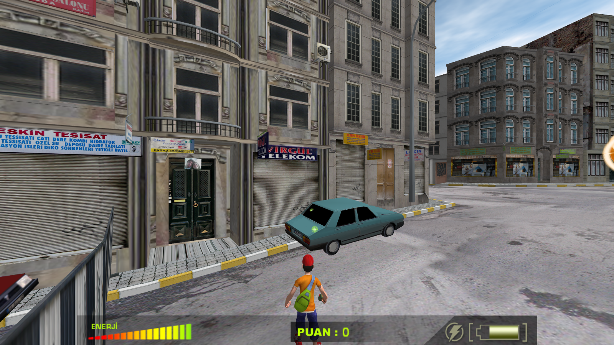
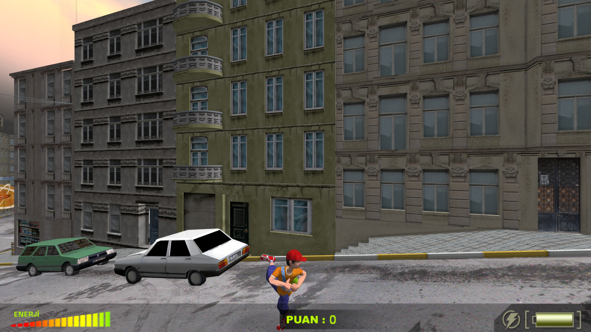
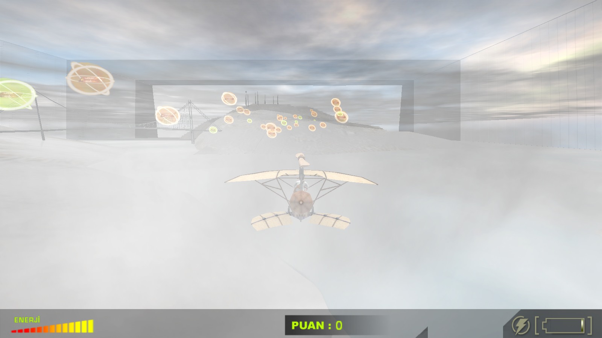
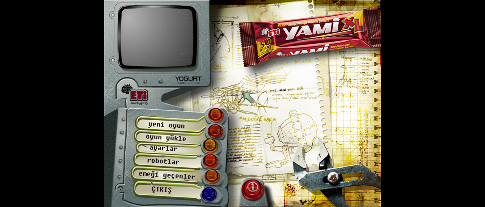
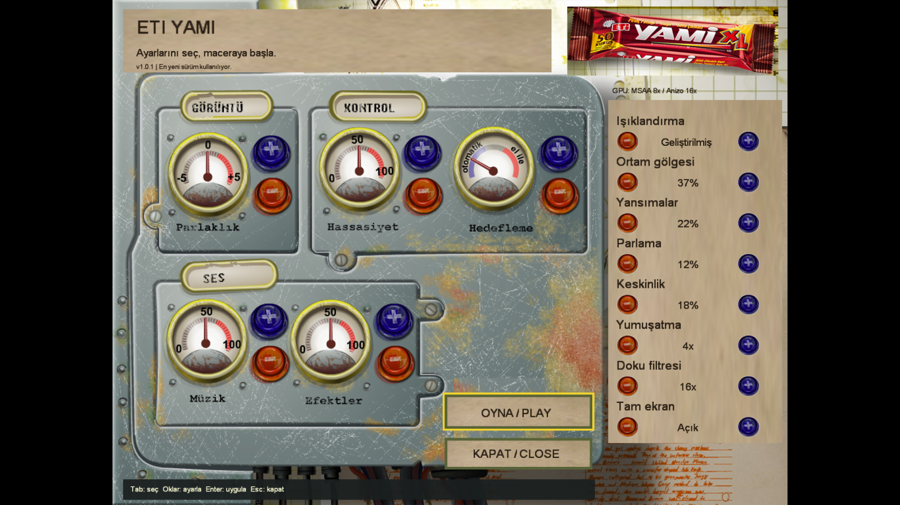

# ETI Yami Native — Linux and Windows

A native C++20/SDL3 reconstruction of **ETI Yami** that runs the original game's artwork, models, scripts, audio and videos without Wine.

## What it is

ETI Yami Native replaces the original Windows engine. It needs no Wine, DirectX installer or Windows codec installation. It adds OpenGL/GLES and Vulkan renderers, optional Vulkan ray tracing, AMD FSR 3.1.4 upscaling and frame generation, a day/night cycle, widescreen support, checkpoints, an ISO installer, and automatic launcher/engine updates.

### Status

Releases are available for Linux (x86_64 and ARM64) and Windows (x86_64). All four levels run on OpenGL, GLES and Vulkan, and automated checks cover assets, scripts, gameplay, audio, settings, rendering and update installation. Full campaign progression has not been played end to end. Physical GPU testing has been done on x86_64 Linux only; native Windows GPU/GLES and physical ARM64 GPU execution are not certified. macOS releases are deferred.



| | |
|---|---|
|  |  |
|  |  |

## You need the original game

**The original game assets are not included in this repository or in the release downloads.** You need a legitimate copy of the original Turkish Yami game (ISO, or the MSI/CAB installer files). The installer reads your ISO directly and never runs the disc's Windows setup. Do not commit or redistribute the original data.

## Download

Get the installer for your system from the [latest release](https://github.com/sergen213/etiyami/releases/latest). No GitHub account is needed.

| System | Installer | Alternative | Manual package |
|---|---|---|---|
| Windows 10/11, 64-bit | [yami-setup-windows-x86_64.exe](https://github.com/sergen213/etiyami/releases/latest/download/yami-setup-windows-x86_64.exe) | | [ZIP](https://github.com/sergen213/etiyami/releases/latest/download/yami-windows-x86_64.zip) |
| Linux x86_64 | [AppImage](https://github.com/sergen213/etiyami/releases/latest/download/yami-setup-linux-x86_64.AppImage) | [.run](https://github.com/sergen213/etiyami/releases/latest/download/yami-setup-linux-x86_64.run) | [ZIP](https://github.com/sergen213/etiyami/releases/latest/download/yami-linux-x86_64.zip) |
| Linux ARM64 | [AppImage](https://github.com/sergen213/etiyami/releases/latest/download/yami-setup-linux-arm64.AppImage) | [.run](https://github.com/sergen213/etiyami/releases/latest/download/yami-setup-linux-arm64.run) | [ZIP](https://github.com/sergen213/etiyami/releases/latest/download/yami-linux-arm64.zip) |

Windows packages are not Authenticode-signed, so SmartScreen may show **Unknown publisher**. Check the download against the SHA256 digest shown on the release page.

## Requirements

- **Linux:** x86_64 or ARM64 with glibc 2.35 or newer, a standard FHS layout (`/bin/sh`, `/usr/bin/env`), and your distribution's graphics drivers and C++ runtime. Alpine/musl is not supported. No root access, FUSE, Wine or 7-Zip is needed.
- **Windows:** 64-bit Windows 10 or 11. No administrator rights are needed.
- **GPU:** OpenGL 3.3 or GLES 3. Vulkan needs a Vulkan 1.3 driver; hardware ray tracing is optional.
- **Disk:** about 640 MiB temporary space and 1.5 GiB plus the engine for the installation. The ISO is not needed after installing.

## Quick start

1. Run the installer as your normal user (on Linux: `chmod +x` the AppImage first; never use sudo).
2. Click **Choose ISO** and select your original Yami ISO.
3. Click **Install game**, then **Launch game**.
4. In the launcher, choose **OYNA / PLAY**, then **Yeni Oyun / New Game**.

Afterwards start **ETI Yami** from the application menu or Start menu. Uninstall with **Uninstall ETI Yami**; it keeps your saves and settings.

Full instructions, the manual ZIP install, uninstalling, saves, updates and troubleshooting: [docs/INSTALL.md](docs/INSTALL.md).

### Controls

| Input | Action |
|---|---|
| W / Up, S / Down | Move forward / backward |
| A / Left, D / Right | Move left / right |
| Mouse | 360° camera orbit, up/down pitch, menu cursor |
| Ctrl or left mouse button | Fire |
| Space | Special action |
| E or Enter | Interact |
| Tab | Objectives |
| Escape | Game menu |
| F11 | Toggle fullscreen |

### Common options

```sh
./yami-launcher --renderer vulkan --ray-tracing on   # Vulkan with ray tracing
./yami-launcher --renderer opengl                     # OpenGL (default)
./yami-launcher --classic-graphics                    # original lighting
./yami-launcher --no-updates                          # no update checks
./yami-native --help                                  # all options
```

All graphics options: [docs/GRAPHICS.md](docs/GRAPHICS.md).

## Build from source

On Arch Linux / CachyOS:

```sh
sudo pacman -S --needed git gcc cmake ninja pkgconf sdl3 libepoxy libxml2 ffmpeg curl libarchive json-c vulkan-headers glslang python
cmake -S . -B build -G Ninja -DCMAKE_BUILD_TYPE=Release
cmake --build build --parallel
./build/yami-launcher --asset-root /path/to/original/game
```

Other distributions, Windows (MSYS2 UCRT64), the ISO installer, extracting from the original MSI/CAB, and tests: [docs/BUILDING.md](docs/BUILDING.md).

## Documentation

- [docs/INSTALL.md](docs/INSTALL.md) — installing, uninstalling, saves, automatic updates, troubleshooting.
- [docs/GRAPHICS.md](docs/GRAPHICS.md) — renderers, ray tracing, FSR, day/night, command-line options.
- [docs/BUILDING.md](docs/BUILDING.md) — building on Linux and Windows, installer, checks.
- [docs/RELEASE_HISTORY.md](docs/RELEASE_HISTORY.md) — per-release notes and verification records.
- [REVERSE_ENGINEERING.md](REVERSE_ENGINEERING.md) — reconstruction notes, implementation details, verification evidence.

## Contributing

Changes are accepted only as pull requests, reviewed and merged by the maintainer. See [CONTRIBUTING.md](CONTRIBUTING.md).

## License

Source-available, all rights reserved. See [LICENSE](LICENSE). Versions published before this license under a different license remain available under that earlier license. Third-party components (such as the AMD FidelityFX SDK under `third_party/`) keep their own licenses.
