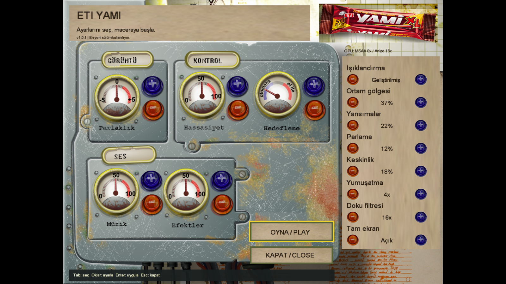

# Installing and playing ETI Yami

The original game assets are not included. You need a legitimate copy of the original Turkish Yami game (ISO, or an extracted `game/` folder).

## Install on Windows

Download **[yami-setup-windows-x86_64.exe](https://github.com/sergen213/etiyami/releases/latest/download/yami-setup-windows-x86_64.exe)** from the latest release. This single-file offline installer supports 64-bit Windows 10/11. Packages are not Authenticode-signed, so SmartScreen may report **Unknown publisher**; verify the download's GitHub SHA256 digest before running it.

1. Run the installer as your normal user, without elevation. Click **Choose ISO** and select your legally owned original Turkish Yami ISO. The installer reads MSI/CAB data directly and never runs the disc's setup, DirectX, or codec installers.
2. Wait for the original artwork preview. The default installation is `%LOCALAPPDATA%\Programs\etiyami`; **Change...** selects another per-user parent folder. Keep the installation writable so automatic updates work.
3. Click **Install game**, then **Launch game**. The installer creates **ETI Yami** and **Uninstall ETI Yami** in Start Menu → **ETI Yami**, plus optional Desktop shortcuts. It bundles application DLLs and the offline ISO tool, not original game assets or saves.

Installation needs about 640 MiB free temporary space for artwork preview and 1.5 GiB plus the engine on the destination volume. The ISO is not needed afterward. Re-running repair against an installer-owned installation preserves its engine, assets, settings, saves, and unknown files while repairing shortcuts and removal support. Unrelated folders and shortcuts are not overwritten.

To uninstall, close the game/launcher/updater and open **Uninstall ETI Yami**. The console shows the exact installation path and asks for confirmation. Only inventory-owned game/engine files and shortcuts are removed. Saves, settings, custom/unrecorded files, and the installation root remain. The original ISO and downloaded installer are not required.

For a manual installation, download **[yami-windows-x86_64.zip](https://github.com/sergen213/etiyami/releases/latest/download/yami-windows-x86_64.zip)**, extract the entire ZIP into a writable folder, and supply the complete original `game/` directory beside the executables:

```text
etiyami/
├── yami-launcher.exe
├── yami-native.exe
├── yami-updater.exe
├── *.dll                       # Keep every supplied runtime DLL
└── game/
    └── data/
        ├── menu/menulist.xml
        └── ...                   # All original data
```

Start `yami-launcher.exe`, or pass `--asset-root "C:\\path\\to\\original\\game"` when assets live elsewhere. The ZIP does not create shortcuts or uninstall ownership records.

## Install on Linux (recommended: AppImage)

Download the installer for your CPU from [the latest public release](https://github.com/sergen213/etiyami/releases/latest). No GitHub account or token is required.

| Computer | Recommended installer | Shell fallback | Advanced manual package |
|---|---|---|---|
| Intel/AMD 64-bit Linux | [x86_64 AppImage](https://github.com/sergen213/etiyami/releases/latest/download/yami-setup-linux-x86_64.AppImage) | [x86_64 .run](https://github.com/sergen213/etiyami/releases/latest/download/yami-setup-linux-x86_64.run) | [x86_64 ZIP](https://github.com/sergen213/etiyami/releases/latest/download/yami-linux-x86_64.zip) |
| 64-bit ARM Linux | [ARM64 AppImage](https://github.com/sergen213/etiyami/releases/latest/download/yami-setup-linux-arm64.AppImage) | [ARM64 .run](https://github.com/sergen213/etiyami/releases/latest/download/yami-setup-linux-arm64.run) | [ARM64 ZIP](https://github.com/sergen213/etiyami/releases/latest/download/yami-linux-arm64.zip) |

Requirements: **x86_64 or ARM64 Linux with glibc 2.35 or newer**, your distribution's compatible graphics drivers and C++ runtime, and an OpenGL 3.3 or GLES 3-capable desktop. Installers bundle application libraries and the offline ISO extraction tool, **not** glibc, `libstdc++`, `libgcc`, or graphics drivers. Standard Linux paths such as `/bin/sh` and `/usr/bin/env` and ordinary per-user XDG application-menu support are required. This is not universal distribution support: Alpine/musl and non-FHS systems are not supported by these binaries merely because they can open an AppImage. No Wine, root access, separately installed 7-Zip, or manual asset extraction is needed.

Published x86_64 and ARM64 packages have native Ubuntu 22.04 CI build and static architecture/runtime-policy verification. Physical GPU/gameplay verification has been performed on x86_64 Linux; ARM64 CI/package checks do **not** establish physical ARM GPU compatibility or verification across every desktop/distribution.

### 1. Run the installer

For an x86_64 download saved in `~/Downloads`:

```sh
chmod +x "$HOME/Downloads/yami-setup-linux-x86_64.AppImage"
"$HOME/Downloads/yami-setup-linux-x86_64.AppImage"
```

For ARM64, substitute `arm64` for `x86_64`. The AppImage uses a static runtime with automatic extraction fallback when FUSE is unavailable; it does not require installing FUSE2. To explicitly run without FUSE:

```sh
"$HOME/Downloads/yami-setup-linux-x86_64.AppImage" --appimage-extract-and-run
```

Alternatively, the `.run` download opens the same installer:

```sh
chmod +x "$HOME/Downloads/yami-setup-linux-x86_64.run"
"$HOME/Downloads/yami-setup-linux-x86_64.run"
```

The `.run` wrapper needs the ordinary shell, `tar`, `gzip`, and coreutils supplied by standard Linux installations. Run either format as your normal desktop user, **never with sudo**.

### 2. Choose your ISO, install, and launch

1. Click **Choose ISO** and select your legally owned original Turkish Yami game ISO. The installer reads its MSI/CAB data natively; it never executes the disc's Windows setup or codec/DirectX installers.
2. Wait for the original artwork and bitmap font to load from that ISO into a private temporary preview.
3. Keep the default installation location, `${XDG_DATA_HOME:-$HOME/.local/share}/etiyami`, or click **Change...** to select a parent folder; the installer creates `etiyami` inside it.
4. Click **Install game**, then **Launch game**. Subsequently open **ETI Yami** from **Apps / the application menu**, which is the primary launcher path. **Uninstall ETI Yami** is registered there too, using the original game icon.
5. Desktop files and their visibility depend on your desktop environment: some show no Desktop icons; others require you to trust/allow launching a file. The installer does not enable icons, install desktop extensions, or change your desktop settings. **In v1.1.1**, Desktop play/uninstall `.desktop` files are secondary and published only when a usable location is available; a missing/disabled/unusable Desktop or an unrelated Desktop-file collision can be skipped while completing the core installation and application-menu repair. Older v1.1.0 installers can refuse an unavailable Desktop.

A `.desktop` file is application-launch metadata, **not a shell script**: select the application in Apps, or open its file with your desktop's launcher support; do not run `sh eti-yami.desktop`.

The ISO can remain anywhere you can read it; you do **not** need to move it beside the installer or game. It is **not needed after installation**. Installation works offline once you have downloaded the installer. Allow 640 MiB free temporary space for the artwork preview and 1.5 GiB plus the native engine on the installation volume for extraction/staging.

**Tab / Shift+Tab** moves between installer controls, **Enter / Space** activates them, and **Escape** cancels a preview/installation or closes an idle installer. Cancellation cleans private staging rather than publishing a partial fresh installation.

Running Install again against an inventory-bearing installer-owned installation preserves its existing assets, engine, settings, and saves and repairs its application-menu entries, Desktop files, and uninstall support; it is not an engine downgrade/replacement. An older installer-owned installation without ownership inventories needs the original ISO once to establish which assets belong to the installer; files without proven ownership are kept. Unrelated folders, symlink destinations, and unrelated shortcuts are never overwritten. Core/application-menu conflicts fail safely. **In v1.1.1**, optional Desktop failures that safely restore the previous state do not prevent installation; incomplete rollback instead fails with retained recovery backups and a manual-recovery error. Older v1.1.0 installers require Desktop publication. Use the launcher's automatic updates for new engine versions.

An older launcher can reject graphics settings saved by a newer engine with `Unknown native graphics field`. If it cannot open to update itself, extract the matching newer release's **entire platform ZIP** into the existing installation directory, keeping its libraries beside the executables. Keep `game/`, saves, settings, and shortcuts; do not reset preferences to work around the version mismatch.

### 3. Play

Launch opens the settings launcher. Choose **OYNA / PLAY**, then **Yeni Oyun / New Game** in the game's main menu. Subsequently use **ETI Yami** in Apps / the application menu (or a Desktop file where supported); the downloaded installer is no longer required.

## Uninstall an installer-created game

Close the game, launcher, and updater, then open **Uninstall ETI Yami** from **Apps / the application menu** (or its optional Desktop file where supported). This shortcut runs the installed `uninstall.sh` in your desktop's terminal, not another AppImage or a graphical uninstaller. The script invokes a small private native removal helper using only the host C/C++ runtime.

The terminal shows the exact installation path and asks for confirmation; answering no or pressing Enter cancels without removing files. After confirmation, only files and shortcuts recorded as installer-owned are removed. Saves, settings, custom files, and any other unknown/unproven files are kept. Only empty recorded child directories are pruned; the installation root itself is always kept, even when empty, and any remaining files are reported.

Neither the original ISO, the downloaded installer, an Internet connection, nor sudo is needed. You can also run the installed script from an existing terminal:

```sh
/bin/sh "${XDG_DATA_HOME:-$HOME/.local/share}/etiyami/uninstall.sh"
```

For a custom location, use that installation's exact `uninstall.sh` path. A manual ZIP installation does not gain uninstall ownership records or these shortcuts automatically. For an older installer installation, rerun the new installer with your original ISO first; missing or invalid ownership records cause removal to refuse rather than guess.

## Advanced: manual ZIP installation

Use the ZIP only if you already have an extracted original asset tree or want to manage the installation yourself.

### 1. Extract the ZIP

Extract the **entire ZIP**, keeping its libraries beside the executables. Use a directory you can write to so automatic updates can install without administrator access. For an x86_64 download saved in `~/Downloads`:

```sh
mkdir -p "$HOME/Games/etiyami"
unzip "$HOME/Downloads/yami-linux-x86_64.zip" -d "$HOME/Games/etiyami"
cd "$HOME/Games/etiyami"
```

For ARM64, substitute `yami-linux-arm64.zip` in the extraction command.

### 2. Supply the original assets

Copy your original game's complete `game/` directory beside the executables. The layout should include:

```text
etiyami/
├── yami-launcher
├── yami-native
├── yami-updater
├── lib*.so*                  # Keep all supplied application libraries
└── game/
    └── data/
        ├── menu/menulist.xml
        └── ...               # All other original data, not just the menu
```

Alternatively, leave the original files where they are and pass `--asset-root` when launching. The asset root is the folder **containing `data/`**, not `data/` itself:

```sh
./yami-launcher --asset-root "/path/to/original/game"
```

See [extracting from the original installer](BUILDING.md#extracting-from-the-original-installer) if you have the MSI/CAB rather than an extracted game directory.

### 3. Start the launcher

```sh
./yami-launcher
```

Choose your settings, then click **OYNA / PLAY**. In the game's main menu, choose **Yeni Oyun / New Game** to start.

The launcher and in-game **Ayarlar / Settings** screen retain the original brightness, sensitivity, aiming mode, and music/effects volume controls alongside lighting, ambient occlusion, reflections, bloom, sharpening, MSAA, texture filtering, fullscreen, and **Gün döngüsü**. The time row selects **Döngü / Gündüz / Gece** (Cycle / Day / Night) and is saved with the other graphics preferences. The launcher stays windowed while you configure settings; the saved fullscreen choice applies when you press Play. Sharpening applies only to OpenGL/GLES; its saved preference is not reset when Vulkan is selected.

Keyboard navigation: **Tab / Shift+Tab** selects a control, **arrow keys** adjust it, **Enter / Space** activates it, and **Escape** closes the launcher. Mouse buttons apply changes on release. Closing saves settings without starting the game.



For backend selection, ray tracing, FSR and all command-line options, see [GRAPHICS.md](GRAPHICS.md).

## Game controls

| Input | Action |
|---|---|
| W / Up, S / Down | Move forward / backward |
| A / Left, D / Right | Move left / right |
| Mouse | 360° horizontal camera orbit, up/down pitch, and original menu cursor |
| Ctrl or left mouse button | Fire |
| Space | Special action |
| E or Enter | Interact |
| Tab | Objectives |
| Escape | Game menu |
| F11 | Toggle fullscreen |

Mouse capture is released when the game loses focus. Camera pitch works in both aiming modes; changing aiming mode does not reset the camera. Automatic-aim shots remain horizontal when no target is selected.

## Saves and settings

Original assets are read-only. Native checkpoints and `game.ini` are stored separately, using SDL's per-user preference directory. On Linux this is normally `${XDG_DATA_HOME:-$HOME/.local/share}/ETI/YamiNative/`; on Windows it is `%APPDATA%\\ETI\\YamiNative\\`.

To choose a different location:

```sh
./yami-launcher --save-dir "$HOME/Games/etiyami-saves"
```

Keep this directory **outside the original asset tree**. The launcher and game share the same settings file; automatic updates preserve the asset and save-directory choices.

## Automatic updates

Start **`yami-launcher`** (`yami-launcher.exe` on Windows) to check for new releases in the background. A newer package matching your OS/architecture is downloaded over HTTPS, checked against GitHub's SHA256 digest, installed by the trusted local update helper, and the launcher restarts automatically. Updates contain engine/launcher files and application libraries, **not original assets or saves**.

- **No GitHub account, authorization code, or token is required** for public releases.
- Keep all three executables and their supplied libraries together in a writable installation directory.
- Offline operation or an unavailable update leaves the installed game playable.
- Use `./yami-launcher --no-updates` to disable network checks.
- Direct `yami-native` gameplay does **not** check for updates; use the launcher to update.

## Troubleshooting

- **Original assets not found:** check that `game/data/menu/menulist.xml` exists and that the complete original data was copied. Use `--asset-root "/path/to/game"` if it is stored elsewhere.
- **Permission denied when launching on Linux:** if your extractor lost executable permissions, run `chmod +x yami-launcher yami-native yami-updater` in the extracted directory. Do not run the game as root.
- **Windows blocks the installer:** packages are unsigned, so SmartScreen may require an explicit **More info → Run anyway** decision after you verify the source and SHA256 digest. No administrator installation is required.
- **Update cannot install:** move the whole installation to a per-user writable directory, such as `~/Games/etiyami` on Linux or `%LOCALAPPDATA%\\Programs\\etiyami` on Windows; keep its libraries and update helper together. Do not install under `C:\\Program Files` for normal play.
- **Graphics startup error:** update your graphics drivers. On Linux, ensure the host C++ runtime is current; the withdrawn 1.0.0 package could conflict with newer Mesa, so repair that installation with the latest fixed package and do not restore its old C++ libraries to `LD_LIBRARY_PATH`. For Vulkan errors, select **OpenGL** in the returned launcher or pass `--renderer opengl`; Vulkan 1.3 and required device features are necessary, while RT is optional.
- **Wayland-specific issue:** Linux prefers Wayland when available. To explicitly try X11 on a desktop that provides it, run `SDL_VIDEO_DRIVER=x11 ./yami-launcher`.
- **Poor performance:** reduce MSAA, filtering, or effects in Ayarlar, or use the lower-cost options in [GRAPHICS.md](GRAPHICS.md#useful-launch-options).

